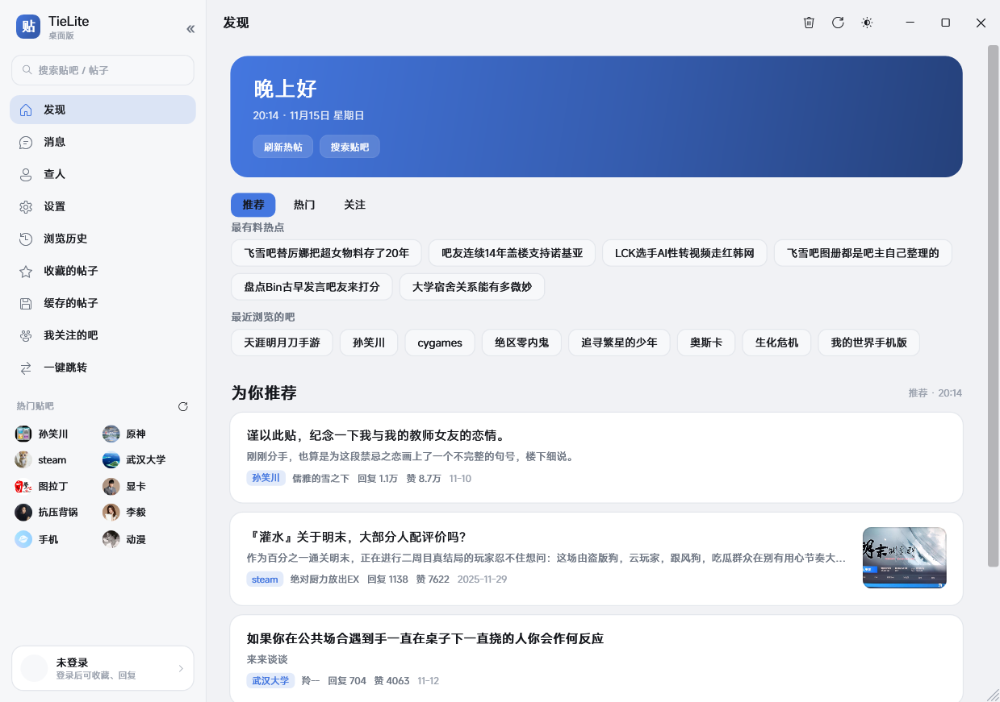
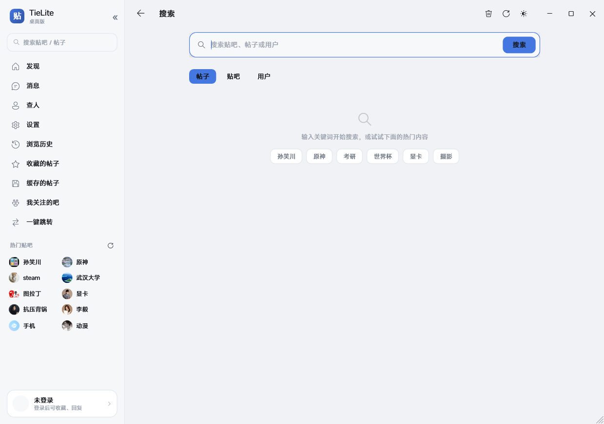
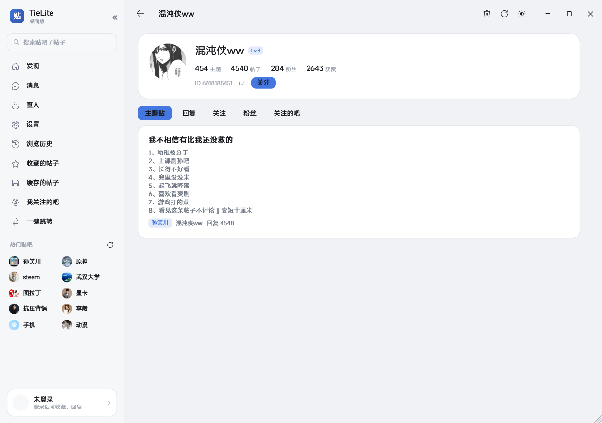
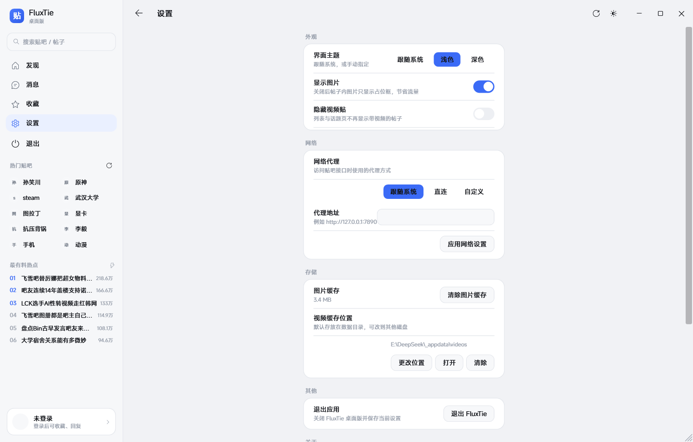
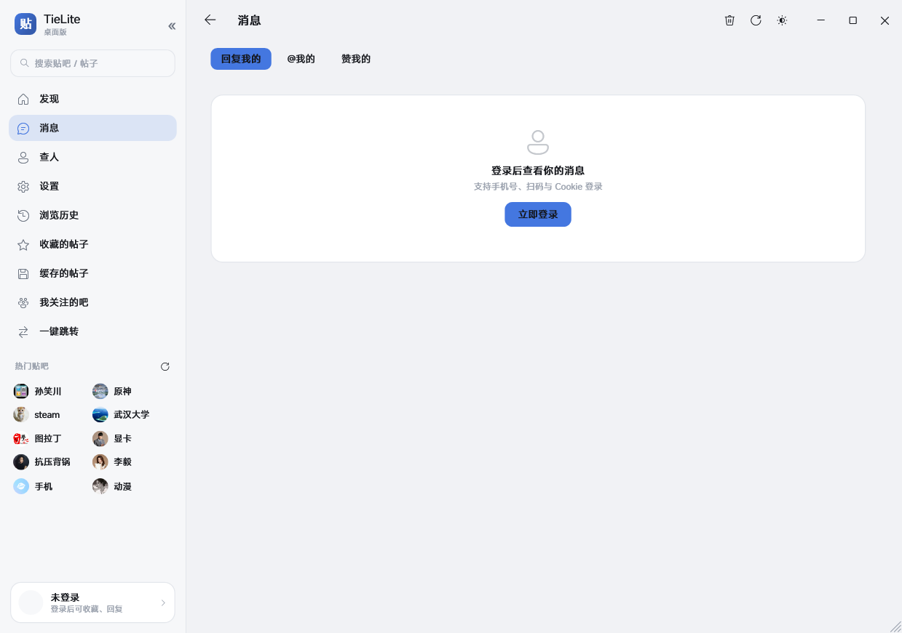
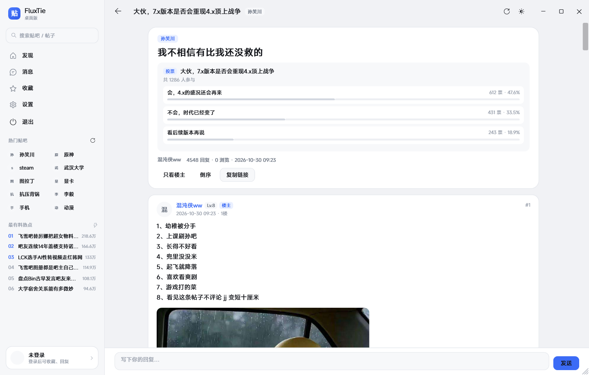

# TieLiteDesktop

<p align="center">
  
</p>

<p align="center">
  <b>Windows 上的第三方贴吧桌面客户端</b><br/>
  WPF · .NET 7 · 无第三方 NuGet 依赖
</p>

> 当前版本：**v1.0.1**  
> 非百度贴吧官方客户端，仅供学习、研究与个人交流使用。

TieLiteDesktop 是基于 Android 客户端 [FluxTie](https://github.com/makise2060/FluxTie) 的协议与交互思路，使用 WPF / .NET 7 从零实现的 Windows 桌面客户端。界面按桌面尺寸重新设计：左侧导航、内容区、卡片化布局、浅色/深色主题，并针对贴吧的 Protobuf 接口做了完整适配。



## 贴吧客户端没有的功能

官方贴吧客户端主要面向移动端信息流，下列桌面场景是 TieLiteDesktop 额外提供的：

- **帖子缓存**：把主题帖和楼层缓存到本地，断网或帖子被删后仍可查看；支持缓存目录、缓存页数、缓存帖子列表与回收站。
- **查人**：侧栏「查人」支持按 UID / 用户名查询用户资料、主题帖、关注与粉丝，不需要先进入某个吧。
- **桌面密码**：六位 PIN 或自定义密码锁定应用，支持手动锁定、启动锁定、任务栏/托盘恢复锁定，以及清除密码并退出登录。
- **自定义启动界面和背景**：自定义启动图、启动背景、16:9 裁剪、卡片透明度、主题色与深浅色主题。
- **一键跳转**：侧栏保存常用吧，一键直接进入指定贴吧，不需要每次搜索。
- **自动签到**：在设置中开启后，启动时自动签到所有已关注的吧，并保留手动「一键签到」入口。

## 功能

### 浏览

- **发现 / 热帖**：贴吧官方热帖流，支持视频、长文、游戏、数码等分类切换。
- **贴吧**：吧信息、关注/签到、按回复时间或发布时间排序、分页加载、吧务展示。
- **帖子**：楼层与楼中楼、正文/图片/表情/@/链接渲染、图片查看器、只读楼主、正序/倒序、复制链接、点赞、回复。
- **楼中楼**：默认预览 3 条，每次展开 10 条，可继续加载到全部，支持收起。
- **搜索**：贴吧、帖子、用户三种模式，热门词推荐与搜索历史。
- **用户主页**：资料卡、主题帖列表、关注/粉丝、性别、IP 属地、吧龄。
- **消息**：回复我的、@ 我的、赞我的、私信提醒。
- **收藏 / 历史 / 缓存帖子**：云端收藏、浏览历史、离线缓存列表。
- **关注吧**：网格/列表展示，支持一键签到与**置顶**；置顶只重排本地列表，不刷新网络。

### 创作与互动

- **发新主题**：标题 + 正文 + 表情面板，支持仅自己可见。
- **回复 / 楼中楼回复**：回复指定楼层、@ 用户、表情插入。
- **发帖风险提醒**：发帖或回复前提示贴吧风控与账号风险，可在设置中关闭。
- **表情包管理**：在设置中选择发帖面板显示哪些表情，隐藏后仍可在管理中重新启用。
- **举报**：帖子、楼层、回复均提供「举报」按钮，跳转贴吧官方举报页。
- **投票**：投票贴展示选项、票数与占比，登录后可直接投票。

### 个性化

- **主题**：跟随系统 / 浅色 / 深色，切换时淡入淡出。
- **主题色**：多种强调色，可自定义。
- **启动背景**：选择图片并手动裁剪为 16:9，可恢复默认。
- **自定义背景**：支持裁剪、卡片透明度 30%–100%，卡片颜色会轻微混入背景色调。
- **文字自适应**：根据当前主题与卡片亮度自动选择深色/浅色文字，夜间模式不会出现黑字黑底。
- **动画**：页面切换、列表进入、标签切换、按钮按压、弹窗打开、锁定/解锁均有缓动动画。

### 安全与系统集成

- **应用密码**：支持 6 位 PIN（六点 + 拨号键盘）或自定义密码，密码使用加盐 SHA-256 保存。
- **锁定界面**：内置锁图标、快捷「清除密码并退出登录」、右上角最小化/最大化/关闭。
- **恢复时锁定**：从任务栏或托盘恢复窗口时要求输入密码，可关闭。
- **托盘**：开启「最小化到托盘」后，关闭窗口可隐藏到托盘；双击恢复。
- **退出询问**：退出时询问最小化到托盘还是直接退出，可勾选不再询问。
- **隐私页**：进入前需验证应用密码，支持更改密码、取消密码、忘记密码。
- **拖放链接**：把 `https://tieba.baidu.com/p/...` 拖进窗口即可打开帖子。
- **网络**：跟随系统代理 / 直连 / 自定义 HTTP 代理；图片内存 + 磁盘缓存。
- **启动动画**：Logo、标题、加载条依次淡入，启动完成后再进入密码界面。

## 截图

<table>
  <tr>
    <td></td>
    <td></td>
  </tr>
  <tr>
    <td></td>
    <td></td>
  </tr>
  <tr>
    <td></td>
    <td></td>
  </tr>
  <tr>
    <td></td>
    <td></td>
  </tr>
  <tr>
    <td></td>
    <td></td>
  </tr>
</table>

## 运行

**要求**

- Windows 10 / 11 x64
- [.NET 7 Desktop Runtime](https://dotnet.microsoft.com/download/dotnet/7.0)

**启动**

```powershell
TieLiteDesktop.exe
```

或双击 `run.bat`。

首次启动会生成本机设备标识；未登录也可以浏览、搜索和看帖。登录支持：

- 手机号验证码登录
- Cookie 登录
- 扫码登陆

## 构建

```powershell
build.bat
```

或手动：

```powershell
dotnet build TieLiteDesktop.csproj -c Release
dotnet publish TieLiteDesktop.csproj -c Release -r win-x64 --self-contained false -o dist
```

项目不依赖任何第三方 NuGet 包，只需要 .NET 7 SDK（含 Windows Desktop 工作负载）。

## 数据与隐私

- 配置、账号、设备标识与图片缓存位于 `%APPDATA%\TieLiteDesktop\`。
- 支持环境变量 `TIELITE_DATA_DIR`（兼容旧变量 `FLUXTIE_DATA_DIR`）指定自定义数据目录。
- 在程序目录放置空的 `portable.txt` 可切换为便携模式（数据保存在 `data\`）。
- 账号 Cookie 仅保存在本机 `account.json`，不会上传。
- 应用密码只保存加盐哈希，不保存明文。
- 所有帖子、图片请求直接发往 `tiebac.baidu.com` / `tieba.baidu.com` / `tiebapic.baidu.com`。

## 项目结构

```
TieLiteDesktop/
├─ App.xaml(.cs)            应用入口、主题、截图/自检模式
├─ Core/
│  ├─ Api/                  TiebaClient（签名与传输）、TiebaApi（业务接口）
│  ├─ Models/               线程、楼层、用户、吧等模型
│  ├─ Proto/                schema 驱动的 protobuf 读写
│  ├─ ContentParser.cs      PbContent → 文本 / 图片 / 表情 / @ / 链接
│  ├─ ImageLoader.cs        图片下载与缓存
│  └─ Services.cs           设置、账号、导航等服务
├─ Controls/                ThreadRow、PostCard、RemoteImage、Ui 等
├─ Views/                   MainWindow、发现、吧、帖子、搜索、用户、消息、收藏、设置、登录
├─ Theme/                   浅色 / 深色资源与控件样式
├─ Assets/                  schema、表情、图标
└─ Fixtures/                离线演示数据
```

## 离线演示

```powershell
TieLiteDesktop.exe --demo
```

演示模式使用 `Fixtures/` 下的接口快照渲染界面，便于无网络或接口受限时预览 UI。

```powershell
TieLiteDesktop.exe --demo --page thread --shot thread.png --delay 2500
```

`--page` 支持 `home | forum | thread | settings | profile | login | topic | messages | favorites` 等页面。

## 已知限制

- 暂不支持带图片/视频发帖（纯文字 + 表情已支持），图片上传接口尚未移植。
- 吧务能力目前覆盖「看团队 + 删帖/删主题」，封禁、置顶、加精等操作未移植。
- 扫码登录依赖百度 passport 页面结构，接口变更时可能失效，可改用 Cookie 登录。
- 视频依赖系统 Media Foundation 解码器；缺少解码器时会自动改用 Edge 播放窗口。
- 部分接口需要登录态；未登录时会给出提示而不是静默失败。

## 免责声明

TieLiteDesktop 是非官方第三方贴吧客户端，与百度贴吧官方无隶属关系。

本程序仅供学习、研究与个人交流使用，不得用于商业用途或违反法律法规的用途。

贴吧内容、用户信息及相关商标版权归百度贴吧及原作者所有。使用本程序产生的账号风险、内容风险由使用者自行承担。

登录信息、应用密码与缓存仅保存在本机，不会上传到本程序作者的服务器。

## 许可

源码基于上游 FluxTie（GPL-3.0）移植，本项目同样以 **GPL-3.0** 发布，见 [LICENSE](LICENSE)。

上游项目：[makise2060/FluxTie](https://github.com/makise2060/FluxTie) · 原作 [HuanCheng65/TiebaLite](https://github.com/HuanCheng65/TiebaLite)。
