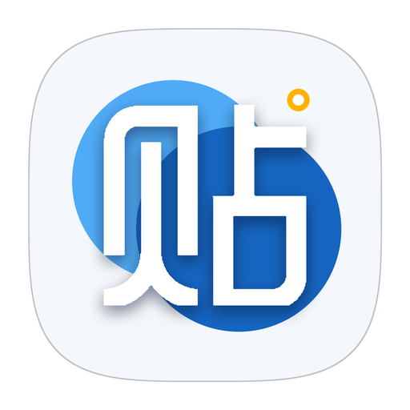
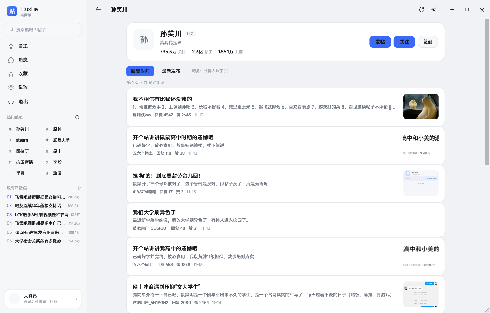
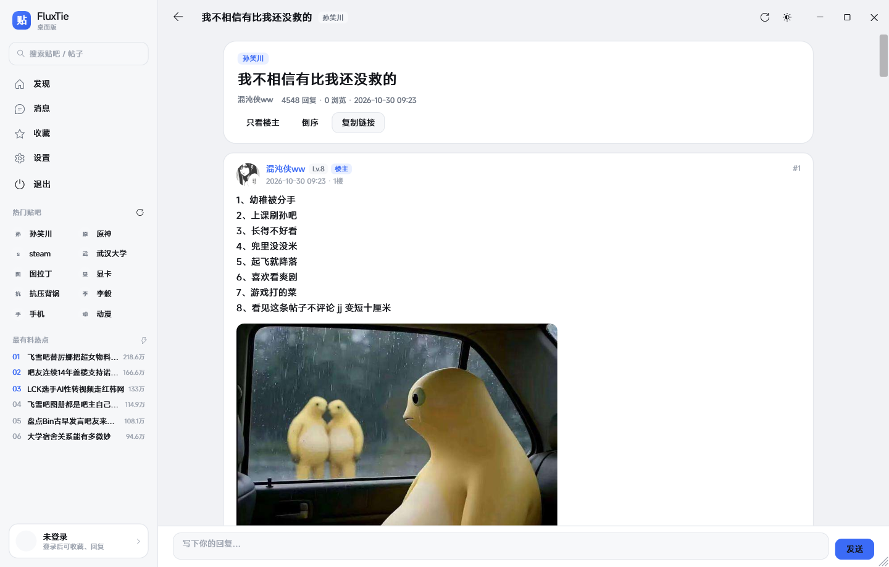
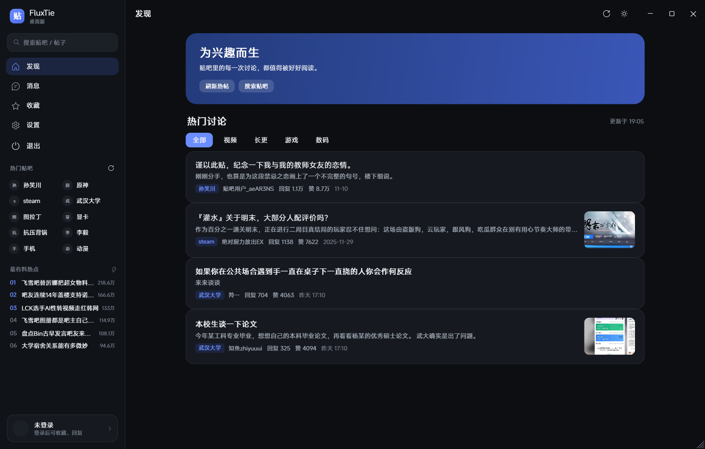
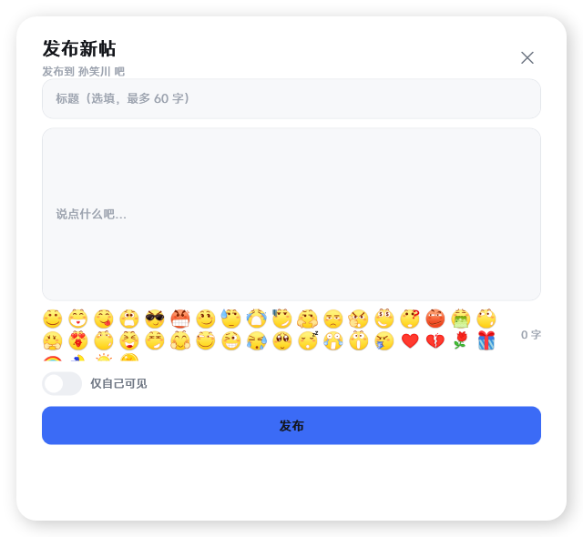
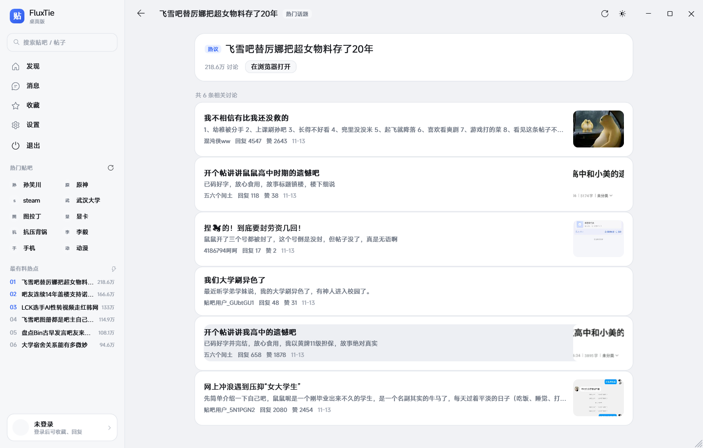
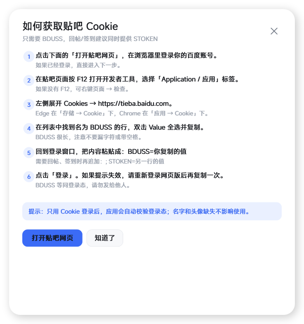

# TieLiteDesktop

<p align="center">
  
</p>

基于 [FluxTie](https://github.com/makise2060/FluxTie)（Android 版贴吧客户端）源码移植的 **Windows 桌面客户端**，使用 WPF / .NET 7 从零实现，没有沿用任何旧的桌面版代码。

界面按桌面尺寸重新设计：左侧导航 + 内容区、可读性更好的帖子排版、深色模式、大图查看器。业务层复刻了 Android 客户端直连贴吧官方接口的请求方式（multipart + md5 签名 + protobuf），不经过任何第三方中转服务器。


## 功能

- **发现 / 热帖**：贴吧官方热帖流，聚合全部频道取热度前 30，帖子右上角标注 TOP1–TOP30，支持视频、长更、游戏、数码等分类切换。
- **侧栏**：10 个推荐贴吧（官方 `getForumHome` 数据）与「最有料热点」话题榜；点击话题进入应用内话题页，查看相关讨论，也可跳转浏览器。
- **话题页**：话题头图、简介、讨论数，以及相关帖子流；接口只返回少量帖子时会用话题名检索补齐相关讨论。
- **视频过滤**：设置中可一键「隐藏视频贴」，首页会同时隐藏「视频」频道，列表与话题页跳过带视频的帖子。
- **缓存位置**：视频缓存目录可在设置中修改到其他磁盘，支持打开目录与一键清理。
- **吧页面**：吧信息、关注 / 签到、按回复时间或发布时间排序、分页加载、吧务展示。
- **帖子页**：楼层与楼中楼、正文 / 图片 / 表情 / @ / 链接渲染、图片大图查看器、只看楼主、倒序、复制链接、点赞、回复。
- **发新主题**：标题 + 正文 + 表情面板，支持「仅自己可见」，发布后直达新帖。
- **投票**：投票帖展示选项、票数与占比，登录后可直接投票。
- **视频**：视频贴在列表中显示封面与播放角标（无封面时显示视频占位图）；播放时先缓存到本地再交给系统解码器，系统缺少解码器时自动用无边框 Edge 窗口播放；HLS 流直接交给 Edge。
- **吧务**：展示吧务团队；吧务可删除任意楼层/主题，普通用户可删除自己的回复与主题（均有二次确认）。
- **搜索**：贴吧与帖子两种模式，热门词推荐。
- **用户主页**：资料卡与主题贴列表。
- **消息**：回复我的 / @ 我的 / 赞我的。
- **收藏**：贴吧云端收藏列表（需登录）。
- **登录**：手机号验证码 / 账号密码 / 扫码（在应用打开的无边框 Edge 登录页完成，自动回读 Cookie）、Cookie 登录（支持完整 Cookie，内置分步教程与「测试登录状态」诊断）。
- **外观**：跟随系统 / 浅色 / 深色三种模式，系统切换主题时自动跟随；可跟随主题的强调色、卡片化布局；Windows 11 下窗口为圆角。
- **动效**：页面切换、列表进场、标签切换、按钮悬停/按压、弹窗打开均为缓动过渡，滚轮平滑滚动，主题切换带淡入淡出。
- **窗口**：无边框自绘标题栏，支持拖动、八向缩放、右下角缩放手柄、最大化/最小化/关闭，另有侧栏「退出」入口；窗口尺寸会被记住。
- **网络**：跟随系统代理 / 直连 / 自定义 HTTP 代理；图片内存 + 磁盘缓存。

<table>
  <tr>
    <td></td>
    <td></td>
  </tr>
  <tr>
    <td></td>
    <td></td>
  </tr>
  <tr>
    <td></td>
    <td></td>
  </tr>
  <tr>
    <td></td>
    <td></td>
  </tr>
  <tr>
    <td></td>
    <td></td>
  </tr>
</table>

## 运行

**要求**：Windows 10/11 x64，已安装 [.NET 7 Desktop Runtime](https://dotnet.microsoft.com/download/dotnet/7.0)。

- 直接运行 `TieLiteDesktop.exe`（或 `run.bat`）。
- 首次启动会生成本机的设备标识；未登录也可以浏览、搜索、看帖。

## 构建

```bat
build.bat
```

或手动：

```bat
dotnet build TieLiteDesktop.csproj -c Release
dotnet publish TieLiteDesktop.csproj -c Release -r win-x64 --self-contained false -o dist
```

项目不依赖任何 NuGet 包，只需要 .NET 7 SDK（含 Windows Desktop 工作负载）。

## 数据与隐私

- 配置、账号、设备标识与图片缓存位于 `%APPDATA%\TieLiteDesktop\`。
- 设置环境变量 `FLUXTIE_DATA_DIR` 可指定自定义数据目录；在程序目录放置空的 `portable.txt` 可切换为便携模式（数据保存在 `data\`）。
- 账号 Cookie 仅保存在本机 `account.json`，不会上传；登录状态等同于浏览器 Cookie，请勿分享该文件。
- 所有帖子、图片请求都直接发往 `tiebac.baidu.com` / `tieba.baidu.com` / `tiebapic.baidu.com`。

## 实现说明

Android 版使用 Wire 生成的 protobuf 类与 Retrofit 拦截器链。桌面版做了等价实现：

1. **协议**：直接复用 Android 工程 `app/src/main/protos` 下的 `.proto`，由 `tools/gen_schema.py` 生成 `Assets/schema.json`；C# 侧的 `ProtoCodec` 按 schema 读写 wire format，因此不需要为 300 多个消息手写类。
2. **签名**：`TiebaClient` 复刻 `CommonParamInterceptor → StParamInterceptor → SortAndSignInterceptor` 的顺序：公共参数 → multipart 表单 → 按字段名排序拼接后加 `tiebaclient!!!` 做 MD5 → `sign` 字段。
3. **图片**：`ImageLoader` 负责下载、磁盘缓存与解码，`RemoteImage` 用 `ImageBrush` 实现圆角裁切与淡入。
4. **表情**：从 Android 工程 `res/drawable` 与贴吧表情 CDN 收集了整套 `image_emoticonN` 资源，行内渲染。

为了保证请求格式与 Android 版一致，仓库里保留了验证工具链（`tools/`）：

- `capture.py`：用 Python 抓取真实接口响应，作为离线 UI 数据；
- 桌面版 `--dump-request <dir>`：导出 C# 组装的原始 multipart 请求；
- `replay.py`：把 C# 生成的请求原样发往贴吧服务器，验证签名与协议；
- `--verify-live <dir>`：用同一套解析代码解码服务器真实响应。

最近一次验证结果：热帖、吧页面、帖子页、吧务信息四个接口均返回 `200`，C# 解析出 4 条热帖、13 条吧内主题、13 层帖子数据，以及 51 名吧务成员。

## 目录结构

```
TieLiteDesktop/
├─ App.xaml(.cs)            应用入口、主题、截图/自检/请求导出模式
├─ Core/
│  ├─ Api/                  TiebaClient（签名与传输）、TiebaApi（业务接口）
│  ├─ Models/               线程、楼层、用户、吧等模型
│  ├─ Proto/                schema 驱动的 protobuf 读写
│  ├─ ContentParser.cs      PbContent → 文本 / 图片 / 表情 / @ / 链接
│  ├─ ImageLoader.cs        图片下载与缓存
│  └─ Services.cs           设置、账号、导航等服务
├─ Controls/                ThreadRow、PostCard、RemoteImage、Ui 等
├─ Views/                   MainWindow、发现、吧、帖子、搜索、用户、消息、收藏、设置、登录
├─ Theme/                   浅色 / 深色资源与控件样式
├─ Assets/                  schema、表情、图标
└─ Fixtures/                离线演示数据
```

## 离线演示

```bat
TieLiteDesktop.exe --demo
```

演示模式使用 `Fixtures/` 下的真实接口快照渲染界面，便于在无网络或接口受限时预览 UI。`--page forum|thread|search|settings|profile|login` 可直接打开指定页面，`--shot out.png` 会把窗口渲染成图片。

## 已知限制

- 暂不支持带图/带视频发帖（纯文字 + 表情已支持）；图片上传接口尚未移植。
- 吧务能力目前覆盖「看团队 + 删帖/删主题」，封禁、置顶、加精等操作未移植。
- 扫码登录依赖百度 passport 页面结构，如接口变更可能失效，可改用 Cookie 登录。
- 视频依赖系统 Media Foundation 解码器；缺少解码器（如 Windows N 版）时会自动改用 Edge 播放窗口。
- 部分接口需要登录态；未登录时会给出提示而不是静默失败。

## 免责声明

本项目仅供学习交流，非百度贴吧官方客户端，不提供任何内容镜像。贴吧内容、商标及相关权利归百度及原作者所有。请勿用于商业用途、冒充官方客户端或违反服务条款的用途。

## 许可

源码基于上游 FluxTie（GPL-3.0）移植，同样以 **GPL-3.0** 发布，见 [LICENSE](LICENSE)。

上游项目：[makise2060/FluxTie](https://github.com/makise2060/FluxTie) · 原作 [HuanCheng65/TiebaLite](https://github.com/HuanCheng65/TiebaLite)。
